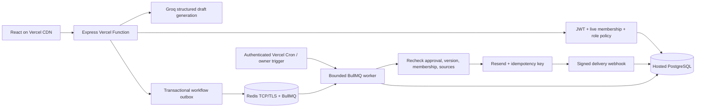

# ResolveFlow AI architecture

Every tenant-owned query carries workspaceId. Composite foreign keys bind ticket messages, drafts, revisions, decisions and workflow/delivery records to the same workspace. Writes that affect approval or external delivery serialize on the workspace row. Provider keys and database credentials stay on the server. Body snapshots and version-bound approvals are preserved separately from current editable drafts.

Groq generation uses approved English keyword evidence and strict structured output; citation IDs and quotes are checked. Optional OpenAI embeddings enable bounded exact vector retrieval. The initial vector threshold and model accuracy still need the frozen live evaluation and human grading.

The dispatcher writes no external message; it hands durable job IDs to Redis. The worker reauthorizes and records outcomes. Local capture is a separate channel that writes files, never claims email delivery. Provider acceptance is not mailbox delivery. At-least-once processing is protected by database state and the provider's time-limited idempotency contract; the system stops uncertain retries before expiry.

On Vercel, no always-on worker lives inside a function. Bounded cron/manual invocations consume durable queued work. A low-frequency default cron is provided for Hobby compatibility; timely processing requires the documented frequent scheduler or a separately hosted persistent worker.
